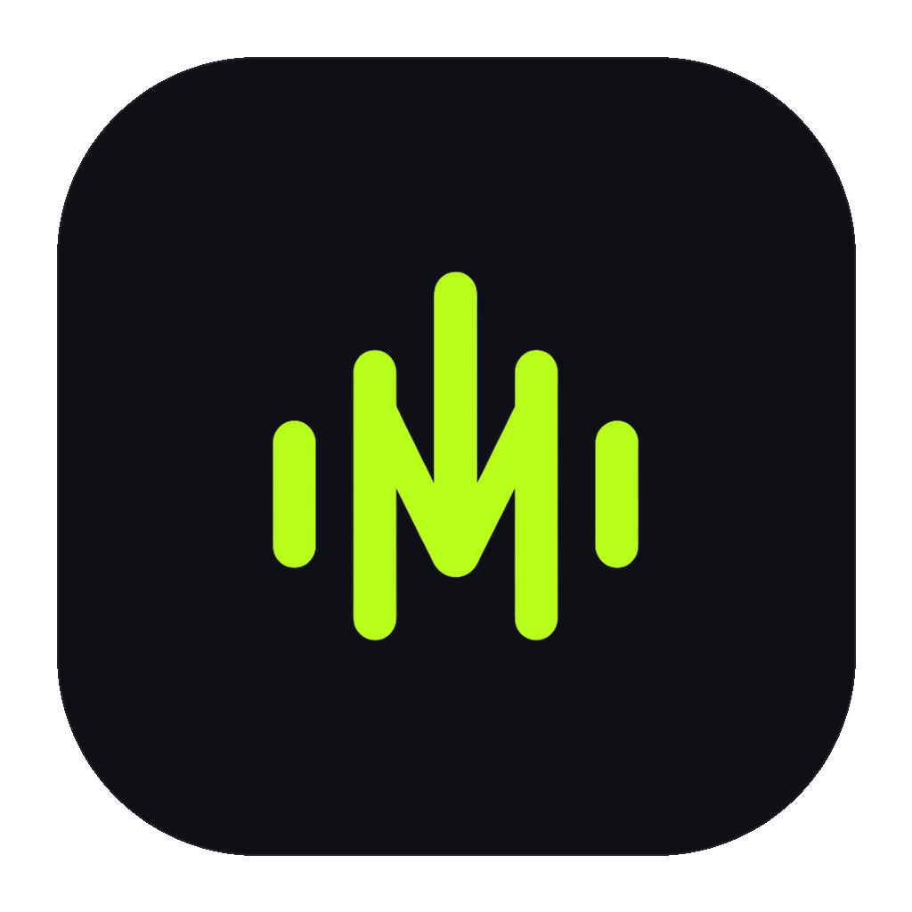

<div align="center">
  
  <h1>Musica</h1>
  <p><strong>A modern, lightweight, Liquid Glass YouTube Music client for Android</strong></p>

  <p>
    
    
    
    
    
  </p>
</div>

---

## Features

- **Consistent 3-Tier Liquid Glass UI** — Refractive translucent bottom navigation bar, MiniPlayer, floating detached sheets, dialogs, popover menus, specular capsule controls, and glass-rimmed grouped cards (with a single toggle in Settings).
- **Rich Browsing & Discovery** — Home editorial picks, 4-row paged quick-pick carousels, Explore duotone category directory, personalized & guest Mixes, Search with live suggestions & grouped results, and full-bleed Artist / Album / Playlist detail pages.
- **High-Quality Media3 Playback** — Multi-source audio stream resolution, dual-ExoPlayer equal-power crossfade, skip silence, playback speed (`0.5×`–`2.0×`), sleep timer with fade-out, interactive drag-to-reorder queue, autoplay, and system equalizer integration.
- **Word & Syllable-Synced Lyrics** — Multi-provider lyrics pipeline (`BetterLyrics`, `LyricsPlus`, `LRCLIB`, `YouTube Music`) with 60fps interpolated highlighting, progressive depth blur, instrumental countdown dots, timing offset control, and long-press line sharing.
- **Offline Downloads & Caching** — Completed-only offline track downloads, configurable audio LRU cache limit, and local playlist management with pin-to-top.
- **Listening History & Replay Stats** — Accurate play-time tracking, grouped history, monthly/yearly/all-time Replay summaries, and local JSON settings backup/restore.
- **Bilingual Support** — Full English and Bahasa Indonesia localization (`System`, `English`, `Bahasa Indonesia`).
- **Lightweight & Fast** — R8-minified ~9 MB release build, scoped Compose state collectors, CPU-cached pre-blurred artwork, right-sized Coil caching, and smooth 60fps scrolling.

---

## Tech Stack

- **UI:** Jetpack Compose, Material 3, Haze (downscaled live backdrop blur), Coil 3, Palette
- **Audio & Media:** AndroidX Media3 (ExoPlayer, MediaSessionService, OkHttp DataSource, DownloadManager)
- **Networking & Data:** Ktor Client, OkHttp, Kotlinx Serialization, Room, DataStore Preferences, Android Keystore (`AES-256-GCM`)
- **Language & Build:** Kotlin, Gradle Kotlin DSL, KSP, R8 Full Mode

---

## Project Structure

```text
app/src/main/java/com/music/musica/
├── core/         # Domain models, Room database, Keystore auth, network monitor, settings store
├── data/         # InnerTube API client & parsers, stream resolvers, lyrics providers, downloads, repositories
├── playback/     # Media3 playback service, dual-player crossfade, queue manager, autoplay, sleep timer
└── ui/           # 3-tier Liquid Glass components, Now Playing, synced lyrics, queue, and feature screens
```

---

## Building from Source

### Prerequisites
- Android Studio (latest stable) or JDK 17+
- Android SDK Platform 37 (compileSdk 37, minSdk 26)

### Commands

```bash
# Run unit tests
./gradlew :app:testDebugUnitTest

# Run Android Lint
./gradlew :app:lintDebug

# Build Debug APK
./gradlew :app:assembleDebug

# Build R8-minified Release APK
./gradlew :app:assembleRelease
```

---

## License

Musica is free software licensed under the **GNU General Public License v3.0 (GPL-3.0)** — see the [LICENSE](LICENSE) file for full details.

---

## Disclaimer

Musica is an independent, open-source YouTube Music client and is not affiliated with, endorsed by, or connected to Google LLC or YouTube.
